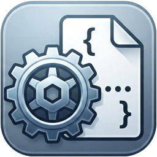
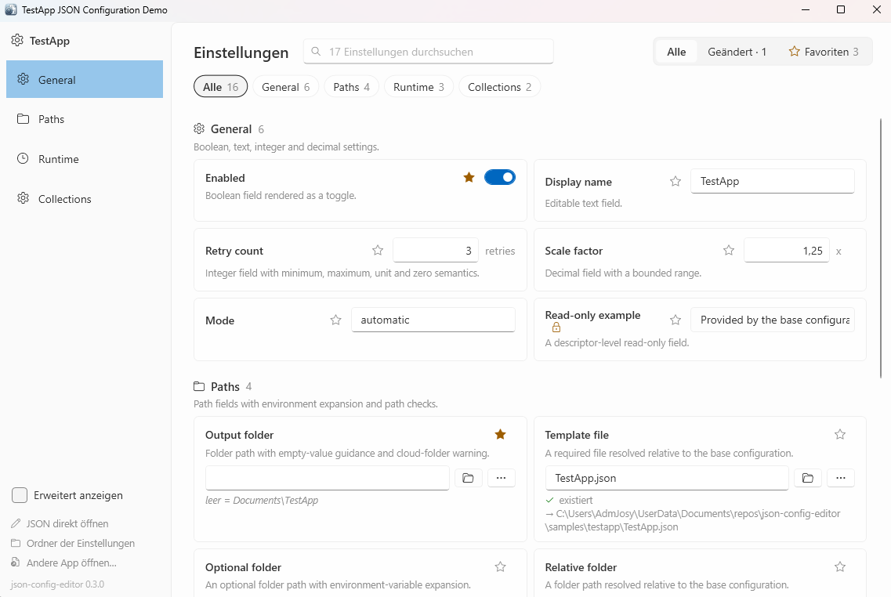

# json-config-editor



Einstellungen in `appsettings.json` übersichtlich bearbeiten, ohne JSON anzufassen. Schalter als Schalter, Zahlen als Zahlen, Pfade mit Durchsuchen und Prüfung. Geschrieben wird nur eine User-Datei unter `%APPDATA%`, und nur das, was vom Standard abweicht. Updates der App überschreiben also nie die Einstellungen des Users.

Windows, WPF mit Fluent-Theme (hell/dunkel folgt Windows). Spec: [docs/SPEC.md](docs/SPEC.md), Änderungen: [CHANGELOG.md](CHANGELOG.md).



## Was es kann

* **Drei Ebenen**: Werks-Defaults (`appsettings.json` neben der App) < IT-Vorgaben (`%ProgramData%\<App>\appsettings.json`) < eigene Werte (`%APPDATA%\<App>\appsettings.local.json`). Was die IT unter `"Locked"` einträgt, ist gesperrt 🔒.
* Pro Feld sichtbar, woher der Wert kommt (Standard / IT-Vorgabe / IT gesperrt / eigener Wert), ↺ setzt zurück.
* **Auto-Erkennung**: `//`-Kommentare in der `appsettings.json` werden zu Beschreibungen, Pfade werden am Key oder Wert erkannt.
* **Descriptor** `appsettings.editor.json` (optional): Labels, Favoriten oben, Einheiten, Grenzen, read-only, versteckt, erweitert, Neustart-Hinweis, Pfadprüfung inkl. OneDrive-Warnung.
* **Sofort speichern**, atomar. Unbekannte Keys, `_hinweis`-Metadaten und Listen in der User-Datei bleiben erhalten.
* **Listen sortieren**: Listen (z. B. eine Mikro-Prioliste) zeigt der Editor mit einer nummerierten Zeile pro Eintrag, ▲ ▼ bzw. Alt+↑ ↓ ändern die Reihenfolge. Zeilentext ist die erste Text-Eigenschaft des Eintrags (z. B. `Name`), alle anderen Eigenschaften bleiben unverändert. Hinzufügen und Löschen gehen weiter im Texteditor.
* **Eigene Favoriten**: Stern ☆ an jedem Feld. Gespeichert in der User-Datei unter `_jsonConfigEditor.favorites`, also pro User. Solange der User keine eigenen hat, gelten die Favoriten aus dem Descriptor; eine leere eigene Liste blendet auch die Descriptor-Favoriten aus.
* Suche mit dynamischer Trefferzahl, Filter pro Abschnitt sowie "Alle", "Geändert" und "Favoriten"-Ansicht; Abschnitte ohne sichtbare Treffer werden ausgeblendet. Strg+F öffnet die Suche.
* **F3**: Debug-Infos mit Aufruf (Kommandozeile), Version, .NET, welche JSON-Dateien benutzt werden (mit Größe und Datum), IT-Sperren, Warnungen, Log-Pfad und Inhalt der User-Datei. "Kopieren" für Tickets, Esc schließt. Die Versionszeile links unten führt zum [GitHub-Projekt](https://github.com/josy1024/json-config-editor).
* Pfadfelder: 📂 öffnet den Ordner im Explorer (bei Dateien mit markierter Datei, fehlt der Ordner: der nächste vorhandene darüber), ⋯ durchsucht. Rechtsklick: Ordner öffnen, Durchsuchen, Pfad kopieren. Geht auch bei gesperrten Feldern.
* Ändert die App die Datei selbst, lädt der Editor neu.
* Ohne Parameter: Startseite mit bekannten Apps (IT-Liste, eigene Liste, zuletzt geöffnet).

## Aufruf

Hauptweg, alles steht im Descriptor der App:

```powershell
JsonConfigEditor.exe "C:\Program Files\PraxisRecorder\appsettings.editor.json" --owner-pid 1234
```

Ohne Descriptor:

```powershell
JsonConfigEditor.exe --base "C:\Program Files\MeineApp\appsettings.json" --app MeineApp
```

| Option | Bedeutung |
|---|---|
| `<pfad>` | `*.editor.json`, `appsettings.json`, `*.local.json` oder Ordner einer App, wird erkannt |
| `--base`, `--user`, `--machine` | Dateien direkt angeben (überschreibt Descriptor) |
| `--app <Name>` | Default-Pfade unter `%APPDATA%` und `%ProgramData%` |
| `--section <Name>` | bei diesem Abschnitt öffnen |
| `--owner-pid <pid>` | schließt sich, wenn die aufrufende App endet |
| `--readonly` | nur anzeigen |
| `--validate` | ohne Fenster prüfen (CI, IT) |
| `--pick` | immer die Startseite zeigen |
| `--list` | bekannte Apps ausgeben |
| `--version`, `--help` | |

Pro User-Datei läuft nur ein Fenster, ein zweiter Aufruf holt es nach vorne. Reagiert das offene Fenster nicht (hängt), sagt der zweite Aufruf das nach ca. 3 Sekunden (Exit `1`), statt sich still zu beenden.

### Exit-Codes

| Code | Bedeutung | Typische Ursache | Was tun |
|---|---|---|---|
| `0` | OK | | |
| `1` | unerwarteter Fehler | Absturz; offener Editor für dieselbe Datei reagiert nicht | Log ansehen (`%LOCALAPPDATA%\JsonConfigEditor\logs`); hängenden `JsonConfigEditor` im Task-Manager beenden |
| `2` | Datei kaputt | Basis- oder User-Datei kein gültiges JSON, Key doppelt (Groß-/Kleinschreibung zählt nicht), Datei über 5 MB, Binärdatei | Zeile und Position stehen in der Meldung; User-Datei: im Editor "Letzten guten Stand wiederherstellen" |
| `3` | Parameterfehler | Pfad falsch oder mit ungültigen Zeichen, Descriptor nicht gefunden, User-Datei unbekannt (`--app` fehlt), User = Basis | Aufruf bzw. `app`-Block im Descriptor prüfen, `--help` |
| `4` | Validierung fehlgeschlagen (`--validate`) | Wert außerhalb `min`/`max`, falscher Typ, Hinweis zum Descriptor (unbekanntes Feld, falscher Typ eines Attributs), Datei nicht UTF-8 | jede Zeile der Ausgabe ist ein Problem |

### Ohne Parameter (Doppelklick)

Liegt genau eine `appsettings.editor.json` neben der EXE oder im aktuellen Ordner, öffnet der Editor sie direkt. Sonst kommt eine Startseite mit allen bekannten Apps, dazu "Andere Datei öffnen…" und Drag & Drop.

Die Liste kommt aus `apps.json`-Dateien und den zuletzt geöffneten Apps:

| Datei | Für |
|---|---|
| `%ProgramData%\JsonConfigEditor\apps.json` | IT, für alle User am Rechner |
| `apps.json` neben `JsonConfigEditor.exe` | Firmen- oder Portable-Paket |
| `%APPDATA%\JsonConfigEditor\apps.json` | eigene Liste ("Eigene Liste bearbeiten" legt sie an) |
| `%APPDATA%\JsonConfigEditor\recent.json` | automatisch, die letzten 10 |

```json
{
  "apps": [
    { "name": "PraxisRecorder", "descriptor": "%ProgramFiles%\\PraxisRecorder\\appsettings.editor.json" },
    { "name": "MeineApp", "base": "C:\\Tools\\MeineApp\\appsettings.json" }
  ]
}
```

`descriptor` oder `base`, optional `user`, `machine`. Relative Pfade gelten ab dem Ordner der `apps.json`. Fehlt eine Datei, bleibt der Eintrag ausgegraut sichtbar.

### Für die IT: Vorgaben und Sperren

`%ProgramData%\<App>\appsettings.json` (bzw. `app.machineFile` im Descriptor) gilt für alle User am Rechner, per GPO, Intune oder Softwareverteilung verteilen:

```json
{
  // Vorgabe: gilt für alle, jeder User darf sie im Editor ändern
  "Output": { "HistoryCount": 20 },
  // gesperrt: gilt über allem, im Editor 🔒 und nicht änderbar
  "Locked": {
    "Output": { "RootPath": "D:\\Aufnahmen" },
    "Tools": { "AllowDownload": false }
  }
}
```

* Unter `Locked` dieselbe Struktur wie in der `appsettings.json` der App.
* Der Editor zeigt die Sperre nur an und schreibt gesperrte Keys nie. Durchsetzen muss sie die App selbst (siehe [In eigene App einbinden](#in-eigene-app-einbinden)).
* Ist die Machine-Datei kaputt, ignoriert der Editor sie mit Hinweis und öffnet trotzdem. `--validate` meldet das.

### Wenn etwas nicht passt

* Kann die User-Datei nicht geschrieben werden (Ordner gesperrt, Datei schreibgeschützt), öffnet der Editor **nur zur Ansicht** und sagt warum.
* Dateien über 5 MB, Binärdateien, Ordner statt Datei, ungültige Zeichen im Pfad: klare Meldung statt Absturz.
* **Kaputte User-Datei** (von Hand vertippt, halb geschrieben): Der Editor zeigt einen roten Hinweis und speichert nichts. Vor jedem Speichern legt er den letzten gültigen Stand als `appsettings.local.json.bak` daneben. Mit "Letzten guten Stand wiederherstellen" kommt der zurück, die kaputte Fassung bleibt als `.kaputt-<Datum>` liegen. Ohne `.bak` bleibt "Sicherung anlegen und neu beginnen" (dann gelten die Standardwerte).
* **Datei gerade gesperrt** (Virenscanner, die App schreibt): Der Wert bleibt im Feld stehen, der Editor versucht es alle 3 Sekunden nochmal ("Noch nicht gespeichert …"). Beim Schließen fragt er, wenn noch etwas offen ist.
* **ANSI statt UTF-8**: Eine User-Datei aus einem alten Editor wird mit richtigen Umlauten gelesen und beim nächsten Speichern als UTF-8 geschrieben. Ist die `appsettings.json` der App nicht UTF-8, kommt ein Hinweis (die App selbst liest sonst falsche Umlaute).
* **Fehler im Descriptor**: Ein falscher Typ (`"min": "5"`, `"fields": []` …) kostet nur diesen Eintrag, der Editor geht trotzdem auf und zeigt einen Hinweis. Nur kaputtes JSON (Syntax) verhindert das Öffnen. `--validate` meldet beides als Fehler.
* Kommentare in der User-Datei gehen beim Speichern verloren (die Fassung davor liegt als `.bak` daneben). Beschreibungen gehören in die `appsettings.json` oder den Descriptor.
* Speichern ist atomar und auf die Platte gezwungen: nach Absturz oder Stromausfall liegt die alte oder die neue Fassung da, nie eine halbe. Übrig gebliebene `*.tmp` älter als 1 Tag räumt der Editor beim Öffnen weg.
* Log: `%LOCALAPPDATA%\JsonConfigEditor\logs`, 7 Tage. Enthält Pfade und Keys, keine Werte.

PowerShell wartet bei GUI-Programmen nicht auf den Exit-Code. Für `--validate` deshalb pipen:

```powershell
.\JsonConfigEditor.exe .\appsettings.editor.json --validate | Out-Host; $LASTEXITCODE
```

## Descriptor

Liegt neben der `appsettings.json` der App und wird mit ihr ausgeliefert. Alles optional. Beispiel: [samples/praxisrecorder/appsettings.editor.json](samples/praxisrecorder/appsettings.editor.json).

```json
{
  "formatVersion": 1,
  "app": {
    "name": "PraxisRecorder",
    "base": "appsettings.json",
    "userFile": "%APPDATA%\\PraxisRecorder\\appsettings.local.json",
    "machineFile": "%ProgramData%\\PraxisRecorder\\appsettings.json"
  },
  "favorites": ["Output:RootPath", "Live:ChunkSeconds"],
  "sections": { "Live": { "label": "Live-Text", "order": 2, "icon": "waveform" } },
  "fields": {
    "Output:RootPath": { "type": "path", "pathKind": "folder", "emptyMeans": "Dokumente\\PraxisRecorder", "warnCloudFolder": true },
    "Recording:MaxMinutes": { "type": "number", "unit": "min", "min": 0, "zeroMeans": "unbegrenzt" },
    "Models:Backend": { "restartRequired": true },
    "Recording:FlushSeconds": { "advanced": true },
    "Audio:PreferredDevices": { "list": { "itemLabel": "Name", "itemDetail": ["LastSeen"] } }
  }
}
```

Feldattribute: `label`, `description`, `type` (`bool`, `int`, `number`, `string`, `path`), `readonly`, `hidden`, `advanced`, `min`, `max`, `unit`, `zeroMeans`, `emptyMeans`, `restartRequired`, `pathKind` (`file`, `folder`), `mustExist`, `expandEnv`, `relativeTo` (`base`), `warnCloudFolder`, bei Listen `list` mit `reorder` (Default `true`), `itemLabel` (Zeilentext), `itemDetail` (kleine Zusatzzeile). Abschnitt-Icons: `mic`, `folder`, `record`, `shield`, `model`, `waveform`, `quality`, `archive`, `tools`, `clock`, `globe`, `user` …

Tipp: Zahlen ohne Punkt in der `appsettings.json` (z. B. `60`) erkennt der Editor als ganze Zahl. Ist in der App ein `double`, im Descriptor `"type": "number"` setzen.

## In eigene App einbinden

Als EXE (empfohlen, eigene App muss dafür nicht AGPL sein):

```csharp
Process.Start(new ProcessStartInfo(editorExe)
{
    ArgumentList = { Path.Combine(AppContext.BaseDirectory, "appsettings.editor.json"), "--owner-pid", Environment.ProcessId.ToString() },
});
```

Die App lädt ihre Config per `FileSystemWatcher` neu, wenn der Editor speichert. Mehr braucht's nicht.

Als DLL in einer WPF-App (abgeleitetes Werk, AGPL gilt):

```csharp
var w = ConfigEditorWindow.Show(new ConfigEditorOptions { DescriptorPath = "appsettings.editor.json" }, owner);
w.Saved += (_, e) => { /* e.ChangedKeys, e.RestartRequired */ };
```

Wichtig für die App: `Locked` aus der Machine-Datei beim Laden als **letzte** Ebene drüberlegen, sonst kann man die Sperre in der User-Datei von Hand aushebeln.

```csharp
var cfg = new ConfigurationBuilder()
    .AddJsonFile(Path.Combine(AppContext.BaseDirectory, "appsettings.json"))
    .AddJsonFile(machineFile, optional: true, reloadOnChange: true)
    .AddJsonFile(userFile, optional: true, reloadOnChange: true);
var locked = new ConfigurationBuilder().AddJsonFile(machineFile, optional: true).Build().GetSection("Locked");
cfg.AddInMemoryCollection(locked.AsEnumerable(makePathsRelative: true).Where(kv => kv.Value != null));
```

Listen (JSON-Arrays) führt `IConfiguration` **nach Index** zusammen: Hat die Basis `["a", "b", "c"]` und die User-Datei `["x"]`, kommt `["x", "b", "c"]` heraus. Für Listen, die der User ersetzen soll, deshalb lieber einen Komma-getrennten String nehmen (`"um, äh, ähm"`), den die App selbst aufteilt. Beim Umsortieren schreibt der Editor immer die ganze wirksame Liste in die User-Datei, damit stimmt das Ergebnis auch bei dieser Mischung.

## Bauen

```powershell
dotnet test tests/JsonConfigEditor.Tests
```

```powershell
dotnet run --project src/JsonConfigEditor.App -- samples/praxisrecorder/appsettings.editor.json --user "$env:TEMP\jce-test.json"
```

Release: Tag `v*` pushen, GitHub Actions baut `JsonConfigEditor-<ver>-win-x64.zip` (framework-dependent, .NET 10 Desktop Runtime nötig) und `SHA256SUMS.txt`.

## Lizenz

AGPL-3.0-or-later, siehe [LICENSE](LICENSE). Aufruf als separate EXE macht die aufrufende App nicht zum abgeleiteten Werk. Kommerzielle Lizenz auf Anfrage.
